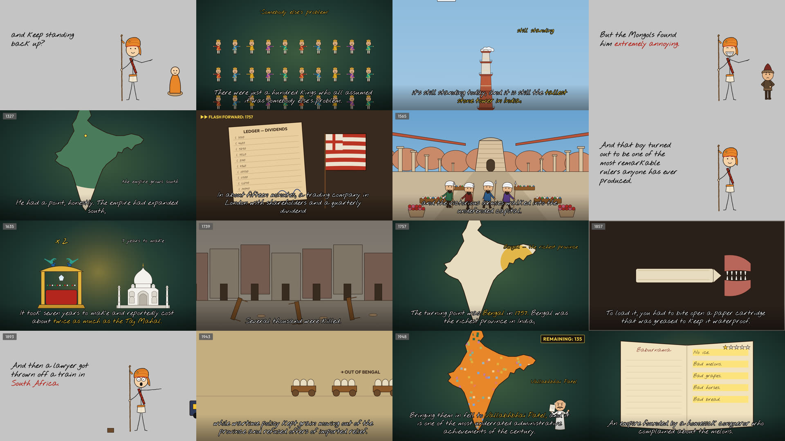
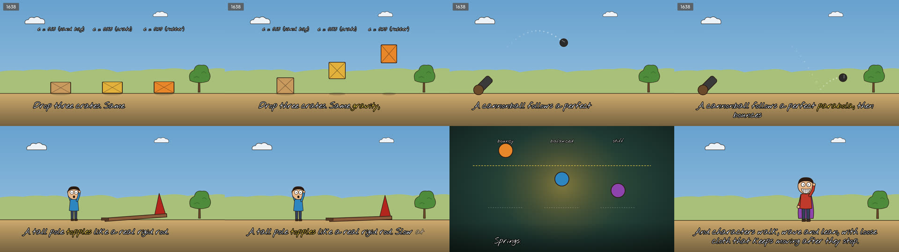

# History Cartoon Studio

**Write a script and get back an animated history explainer**, with a recurring hand-drawn narrator, storybook scenes, handwritten captions, real physics and synthesised sound effects.

Every frame is drawn in code (React + SVG) and rendered headless (Playwright + ffmpeg). Every sound is synthesised in code (numpy). There are no stock images, no AI-generated art and no samples, so the output is deterministic and entirely yours.



## What you need to do

1. Write a script (plain text or Markdown).
2. Optionally, record yourself reading it (`voiceover.mp3`).
3. Hand both to Claude (Claude Code, or the Claude app with this repo attached) and say *"make a video from this script"*.

Claude reads [`CLAUDE.md`](CLAUDE.md) and follows the whole procedure:
- fact-check the script and correct it
- split it into timed beats
- direct and draw every shot, reusing the scene library and drawing new scenes in the same style
- check contact sheets of the stills
- render the film and mix the sound

It works with any Claude that can run commands in a copy of this repo.

## Doing it yourself

```bash
npm install
npx playwright install chromium
pip install -r requirements.txt          # numpy + scipy for the sound effects
node scripts/studio.mjs doctor           # checks everything is in place

npm run demo                             # renders projects/physics-demo/out/physics-demo.mp4
```

```bash
node scripts/studio.mjs new my-film "The Story of Tea"   # copies the template (a tiny working film)
# edit projects/my-film/script.md
node scripts/studio.mjs draft my-film       # script → beats/00-draft.json
# direct the beats, write shots.tsx (see CLAUDE.md §4–5)
node scripts/studio.mjs check my-film       # timeline + bundle + lists shots that still need drawing
node scripts/studio.mjs stills my-film      # contact sheets of every beat → out/stills/sheet_*.png
node scripts/studio.mjs all my-film         # render + sound → out/my-film.mp4
```

With a voiceover, drop `voiceover.mp3` in the project folder and run `node scripts/studio.mjs align my-film` before `check`. The film is then timed to your voice, and the narrator's mouth follows it ([docs/VOICEOVER.md](docs/VOICEOVER.md)).

## Physics

Falls, bounces, throws, toppling poles, swinging signs and springy pops all come from the actual equations. They are closed-form where possible, with RK4 integration for the rigid rod, and every one is a pure function of the frame number. That makes rendering parallel and lets you re-render a single shot and splice it into a finished film. `npm test` checks each helper against its equation. See [docs/PHYSICS.md](docs/PHYSICS.md).



## What's in the repo

| | |
|---|---|
| [`CLAUDE.md`](CLAUDE.md) | The complete production procedure, written for Claude and readable by people |
| [`docs/STYLE.md`](docs/STYLE.md) | The style bible: beat types, palette, layout rules, humour and restraint, fact-checking |
| [`docs/SCENES.md`](docs/SCENES.md) | Catalogue of characters, scenes, maps and props |
| `engine/` | The renderer, the narrator, the physics and the scene library, shared by every film |
| `projects/_template` | Starting point for a new film (a 45-second working example) |
| `projects/physics-demo` | One shot per physics helper |
| `projects/india-1000-years` | A full 40-minute production (529 beats) to learn from |
| `scripts/studio.mjs` | The CLI: `doctor new draft align timeline build check stills render sfx mux all` |

## Licence

The code is released under the MIT licence (see [LICENSE](LICENSE)). The bundled fonts, *Nothing You Could Do* and *Outfit*, are under the SIL Open Font License; see `assets/fonts/*-OFL.txt`. Videos you make are yours.
